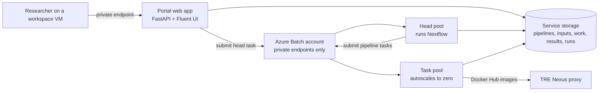

# Nextflow workspace service (spike)

!!! warning
    This workspace service is an early prototype. Use it to evaluate running Nextflow pipelines in a workspace, not for production research.

The Nextflow workspace service adds a web portal to a workspace. Researchers use it to choose a pipeline, fill in a form generated from the pipeline's parameter schema, and follow the run. They then view the published results in the browser. The idea follows [MAcWorP](https://github.com/cubimedrub/macworp), adapted to the TRE's network and data controls.

## How it works



- **Portal:** a container on the workspace App Service plan. It has no public network access and serves a React and Fluent UI front end that matches the TRE portal. Users sign in with the workspace app registration and need the WorkspaceOwner or WorkspaceResearcher role.
- **Nextflow head:** each run starts as an Azure Batch container task on the head pool. The head process uses Nextflow's `azurebatch` executor to submit the pipeline's tasks to the task pool. Pipeline code runs on Batch nodes, never in the portal.
- **Batch pools:** both pools are in a dedicated workspace subnet. They have no public IP addresses, use simplified node communication through a private endpoint, and send any other traffic through the TRE firewall. They scale to zero when idle.
- **Storage:** a service storage account with shared keys disabled and a private endpoint. Nextflow issues short-lived user delegation SAS tokens to its tasks. Work directories are deleted after the configured retention period.
- **Progress:** an `nf-weblog` receiver beside the head process writes run events to storage, and the portal reads them. Batch nodes never connect to the portal.

## Identities

| Identity | Roles | Used by |
| --- | --- | --- |
| Portal | AcrPull on the TRE ACR, Azure Batch Job Submitter on the service Batch account, Storage Blob Data Contributor on the service storage, Key Vault Secrets User on its two secrets | Portal web app |
| Head | AcrPull, Azure Batch Job Submitter, Storage Blob Data Contributor | Head pool nodes |
| Worker | AcrPull | Task pool nodes, to prefetch the runtime image |

No identity can create, resize or delete Batch pools, and none has roles outside the workspace service's resources and the TRE ACR.

## Network access

The service adds no firewall rules for the Batch subnet. Batch, storage and the TRE ACR are reached through private endpoints. Docker Hub images come through the Nexus proxy.

The install pipeline adds Microsoft Entra ID sign-in rules, the same as Gitea, for the web apps and services subnets only:

- `AzureActiveDirectory` on TCP 443, so the portal can exchange the sign-in code and workspace VM browsers can sign in.
- `aadcdn.msftauth.net` and `aadcdn.msauth.net`, for the sign-in page assets.

## Using the portal

1. Open the service's connection URL from a workspace VM.
1. On **Pipelines**, choose **Launch** for a pipeline, fill in the parameters and select **Start run**. File parameters list files from the service's inputs and results storage.
1. Follow the run on the **Overview** tab. When it finishes, view files on **Results** and the Nextflow report, timeline and trace on **Reports**.

To add a pipeline, upload its folder to **Data** > **Pipelines**. The folder needs:

- `main.nf`, with a `container` for every process. Only Docker Hub images can be pulled through Nexus. Each image needs `bash` and `ps` (the `procps` package), because the portal turns on Nextflow's execution report and trace. Slim images such as `python:3.12-slim` don't have `ps`.
- Optionally `nextflow_schema.json` in nf-core format. The portal generates the launch form from it. Parameters with `"format": "file-path"` or `"directory-path"` get a storage picker.

Pipelines run offline. Nextflow can't download plugins or pipelines from GitHub, and the image only contains `nf-azure` and `nf-weblog`.

Upload inputs to **Data** > **Inputs** from inside the workspace, for example after an Airlock import. To take results out of the workspace, use an Airlock export request.

## Properties

| Property | Description |
| --- | --- |
| `worker_vm_size` | VM size for pipeline tasks. Nodes run one task slot per vCPU, as Nextflow requires. |
| `worker_max_nodes` | Maximum task nodes. |
| `worker_use_spot` | Use Spot VMs for tasks. |
| `head_vm_size`, `head_max_nodes` | Head pool size. Each head node runs two runs at once. |
| `work_retention_days` | Days to keep Nextflow work directories. |

## Prerequisites and limitations

- Deploy the Nexus shared service so task nodes can pull Docker Hub images. Images from quay.io, Wave or other registries aren't available.
- The subscription needs a free Azure Batch account quota in the region (the default is low). New Batch accounts get core quota for older VM families such as Dv3 and Esv3 but none for v5 families, so the service offers Dv3 and Esv3 sizes.
- The service creates a `privatelink.batch.azure.com` private DNS zone in the workspace resource group, so a workspace can have only one Nextflow service.
- Cancelling a run stops the head task. Tasks that are already running can finish before Nextflow cleans up its Batch jobs.
- The spike has no Airlock integration in the portal, no pipeline catalogue curation, and no per-run access control beyond workspace roles.

## Developing the portal

The portal is in `templates/workspace_services/nextflow/app`.

```bash
cd templates/workspace_services/nextflow/app
python -m venv .venv && . .venv/bin/activate
pip install -r requirements-dev.txt
(cd ui && npm ci && npm run build)
NF_DEV_MODE=true uvicorn nfportal.main:create_app --factory --port 8000
python -m pytest
```

Development mode skips sign-in, keeps data in `.devdata/`, and simulates runs without Azure.
