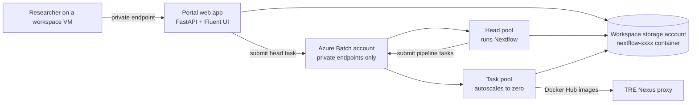

# Nextflow workspace service (spike)

!!! warning
    This workspace service is an early prototype. Use it to evaluate running Nextflow pipelines in a workspace, not for production research.

The Nextflow workspace service adds a web portal to a workspace. Researchers use it to choose a pipeline, fill in a form generated from the pipeline's parameter schema, and follow the run. They then view the published results in the browser. The idea follows [MAcWorP](https://github.com/cubimedrub/macworp), adapted to the TRE's network and data controls.

## How it works



- **Portal:** a container on the workspace App Service plan. It has no public network access and serves a React and Fluent UI front end that matches the TRE portal. Users sign in with the workspace app registration and need the WorkspaceOwner or WorkspaceResearcher role.
- **Nextflow head:** each run starts as an Azure Batch container task on the head pool. The head process uses Nextflow's `azurebatch` executor to submit the pipeline's tasks to the task pool. Pipeline code runs on Batch nodes, never in the portal.
- **Batch pools:** both pools are in a dedicated workspace subnet. They have no public IP addresses, use simplified node communication through a private endpoint, and send any other traffic through the TRE firewall. They scale to zero when idle.
- **Storage:** a container in the workspace storage account, reached through the workspace's existing private endpoint. Nextflow issues short-lived user delegation SAS tokens to its tasks. The portal deletes work directories after the configured retention period.
- **Progress:** an `nf-weblog` receiver beside the head process writes run events to storage, and the portal reads them. Batch nodes never connect to the portal.

## Identities

| Identity | Roles | Used by |
| --- | --- | --- |
| Portal | AcrPull on the TRE ACR, Azure Batch Job Submitter on the service Batch account, Storage Blob Data Contributor on the service container, Storage Blob Delegator on the workspace storage account, Key Vault Secrets User on its two secrets | Portal web app |
| Head | AcrPull, Azure Batch Job Submitter, Storage Blob Data Contributor on the service container, Storage Blob Delegator | Head pool nodes |
| Worker | AcrPull | Task pool nodes, to prefetch the runtime image |

No identity can create, resize or delete Batch pools, and none has data access outside the service's container, its Batch account and the TRE ACR.

## Network access

The service adds no firewall rules for the Batch subnet. Batch, storage and the TRE ACR are reached through private endpoints. Docker Hub images come through the Nexus proxy.

The install pipeline adds Microsoft Entra ID sign-in rules, the same as Gitea, for the web apps and services subnets only:

- `AzureActiveDirectory` on TCP 443, so the portal can exchange the sign-in code and workspace VM browsers can sign in.
- `aadcdn.msftauth.net` and `aadcdn.msauth.net`, for the sign-in page assets.

## Built-in pipelines

| Pipeline | What it does | Data |
| --- | --- | --- |
| **1000 Genomes British (GBR) germline demo** (`uk-1kg-germline`) | FastQC, BWA-MEM, samtools, bcftools and MultiQC. Calls variants around the CYP2D6 pharmacogene, annotates them with British and continental allele frequencies, and compares them with the 1000 Genomes calls. | 30x reads for British sample HG00096 from the 1000 Genomes high-coverage release, sliced to chr22:41.6–42.6 Mb during the image build. |
| **pgsc_calc: polygenic scores** (`pgsc-calc`) | The [PGS Catalog Calculator](https://github.com/PGScatalog/pgsc_calc) v2.3.0 from the University of Cambridge and EMBL-EBI. | CINECA synthetic genomes scored with PGS001229, a height score trained on UK Biobank. |
| **TRE demo pipeline** (`tre-demo`) | A quick check that Batch, Nexus and storage work. | Simulated. |

The germline demo uses [StaPH-B](https://staphb.org/docker-builds/) images from Docker Hub. pgsc_calc uses images from `ghcr.io`, which Batch nodes can't reach, so a TRE administrator copies them into the TRE container registry after deploying the service:

```bash
templates/workspace_services/nextflow/mirror-pipeline-images.sh <acr-name>
```

The script imports each image listed in a pipeline's `images.txt` as `<acr-name>.azurecr.io/mirror/<image>`.

### Adapting a pipeline to the TRE

A pipeline folder can contain two TRE-specific files:

- `tre_schema.json` replaces `nextflow_schema.json` in the launch form, for example to leave out options that need internet access. The pipeline still validates its parameters against its own schema.
- `tre.config` is applied before the TRE's own settings. `@TRE_REGISTRY@` in it is replaced with the TRE container registry, so it can point the pipeline at mirrored images.

## Where files are stored

The service keeps its files in a container named `nextflow-<last 4 characters of the service ID>` in the workspace storage account (`stg<workspace>`). Reusing that account saves a storage account and a private endpoint for each service, because storage accounts are limited per subscription and region. The container has a folder for each area:

| Folder | Contents | Retention |
| --- | --- | --- |
| `pipelines/` | Pipeline folders uploaded on **Data** > **Pipelines** | Until deleted |
| `inputs/` | Files uploaded on **Data** > **Inputs** | Until deleted |
| `results/<run id>/` | The files a run publishes, and `_nextflow/` with the Nextflow report, timeline, trace and log | Until deleted |
| `work/<run id>/` | Nextflow task directories with intermediate files | Deleted by the portal `work_retention_days` after the run ends |
| `runs/<run id>/` | Run status, generated configuration, parameters and progress events | Until deleted |

The portal and Nextflow head identities have Storage Blob Data Contributor on this container only, and Storage Blob Delegator on the account so Nextflow can issue user delegation SAS tokens to tasks.
A delegation SAS can't grant more than its creator's data access, so pipelines can't read the rest of the workspace storage, such as the `datalake` container or the VM file share. Researchers browse the container on the portal's **Data** page.

## Using the portal

1. Open the service's connection URL from a workspace VM.
1. On **Pipelines**, choose **Launch** for a pipeline, fill in the parameters and select **Start run**. For file parameters, select **Browse** to choose a file from **Inputs** or an earlier run's **Results**.
   If the pipeline schema gives the parameter a `pattern`, such as `^\S+\.f(ast)?q(\.gz)?$`, the browser shows only matching files and the portal rejects other files.
1. Follow the run on the **Overview** tab. When it finishes, the **Results** tab shows the run's key outputs, such as its HTML reports, and a folder browser of everything it published. The Nextflow report, timeline and trace are on **Reports**.

To add a pipeline, select **Import pipeline (.zip)** on **Pipelines**, or upload its folder to **Data** > **Pipelines**. Airlock imports a single file per request, so a zip suits pipelines that come into the workspace through Airlock.
The portal extracts the zip into `pipelines/<name>/`. If all files are in one top-level folder, the folder name becomes the pipeline name. It rejects unsafe paths and symbolic links, and asks before replacing a pipeline with the same name.
The pipeline folder needs:

- `main.nf`, with a `container` for every process. Only Docker Hub images can be pulled through Nexus. Each image needs `bash` and `ps` (the `procps` package), because the portal turns on Nextflow's execution report and trace. Slim images such as `python:3.12-slim` don't have `ps`.
- Optionally `nextflow_schema.json` in nf-core format. The portal generates the launch form from it. Parameters with `"format": "file-path"` or `"directory-path"` get a storage picker.

Pipelines run offline. Nextflow can't download plugins or pipelines from GitHub, and the image only contains the `nf-azure`, `nf-weblog` and `nf-schema` plugins.

Upload inputs to **Data** > **Inputs** from inside the workspace, for example after an Airlock import. To take results out of the workspace, use an Airlock export request.

## Properties

| Property | Description |
| --- | --- |
| `worker_vm_size` | VM size for pipeline tasks. Nodes run one task slot per vCPU, as Nextflow requires. |
| `worker_max_nodes` | Maximum task nodes. |
| `worker_use_spot` | Use Spot VMs for tasks. |
| `head_vm_size`, `head_max_nodes` | Head pool size. Each head node runs two runs at once. |
| `work_retention_days` | Days to keep Nextflow work directories. |

## Prerequisites and limitations

- Deploy the Nexus shared service so task nodes can pull Docker Hub images. Images from quay.io, ghcr.io, Wave or other registries are only available after they're copied into the TRE container registry.
- The subscription needs a free Azure Batch account quota in the region (the default is low). New Batch accounts get core quota for older VM families such as Dv3 and Esv3 but none for v5 families, so the service offers Dv3 and Esv3 sizes.
- The service creates a `privatelink.batch.azure.com` private DNS zone in the workspace resource group, so a workspace can have only one Nextflow service.
- Cancelling a run stops the head task. Tasks that are already running can finish before Nextflow cleans up its Batch jobs.
- The spike has no Airlock integration in the portal, no pipeline catalogue curation, and no per-run access control beyond workspace roles.

## Developing the portal

The portal is in `templates/workspace_services/nextflow/app`.

```bash
cd templates/workspace_services/nextflow/app
python -m venv .venv && . .venv/bin/activate
pip install -r requirements-dev.txt
(cd ui && npm ci && npm run build)
NF_DEV_MODE=true uvicorn nfportal.main:create_app --factory --port 8000
python -m pytest
```

Development mode skips sign-in, keeps data in `.devdata/`, and simulates runs without Azure.
